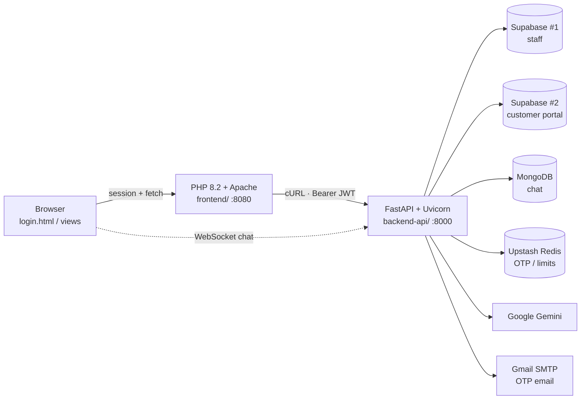

# Priority Handling CRM

> **CRM & Business Control System** — a full-stack customer relationship platform for a logistics/freight-forwarding operation, with multi-role access control, live chat, quotations, shipment booking, and a 4-tier business intelligence suite.

[](https://github.com/ian-dev-shit/customer_relationship/actions/workflows/backend-ci.yml)
[](https://github.com/ian-dev-shit/customer_relationship/actions/workflows/frontend-ci.yml)
[](https://www.python.org/)
[](https://fastapi.tiangolo.com/)
[](https://www.php.net/)

---

## Table of Contents

- [Overview](#overview)
- [Tech Stack](#tech-stack)
- [Architecture](#architecture)
- [Features by Role](#features-by-role)
- [Project Structure](#project-structure)
- [Prerequisites](#prerequisites)
- [Getting Started](#getting-started)
- [Environment Variables](#environment-variables)
- [API Reference](#api-reference)
- [Testing](#testing)
- [CI/CD](#cicd)
- [Security](#security)
- [Troubleshooting](#troubleshooting)
- [Known Limitations](#known-limitations)
- [Project Scripts & Tooling](#project-scripts--tooling)
- [Contributing](#contributing)
- [License](#license)

---

## Overview

The system is split into two deployable services:

| Service | Directory | Port | Role |
|---|---|---|---|
| **Backend API** | `backend-api/` | `8000` | FastAPI REST + WebSocket API, business logic, analytics, PDF generation |
| **Frontend** | `frontend/` | `8080` (Docker) / Apache docroot | PHP 8.2 server-rendered views + vanilla JS client that talks to the backend |

Users authenticate with email + password, then confirm a **6-digit OTP sent by email**. A JWT is issued and stored in the PHP session; every subsequent request is forwarded to FastAPI as a `Bearer` token.

Four roles exist, enforced end-to-end by a `RoleChecker` RBAC guard:

`super_admin` · `admin` · `sales_agent` · `customer`

---

## Tech Stack

| Layer | Technology |
|---|---|
| Backend framework | **FastAPI** 0.139 + **Uvicorn**, Pydantic v2 (`pydantic-settings`) |
| Backend language | **Python** 3.12 (Docker) / 3.13.3 (CI) |
| Frontend | **PHP** 8.2 (Apache), server-rendered views, **Tailwind CSS**, vanilla JS |
| Primary datastore | **Supabase #1** (staff: admins, sales agents) |
| Secondary datastore | **Supabase #2** (customer portal + shared tables) |
| Chat datastore | **MongoDB** (via `pymongo` / `motor`) |
| Cache / OTP store | **Upstash Redis** (REST) |
| Auth | Supabase Auth → JWT, **email OTP** over Gmail SMTP (port 465) |
| AI | **Google Gemini** (`google-genai`) for AI-assisted features |
| Analytics / BI | **pandas**, **scikit-learn**, **statsmodels**, **matplotlib**, **numpy** |
| Documents | **WeasyPrint** (quotation PDF), **Jinja2** templates, **reportlab** |
| Email | `smtplib` (Gmail SMTP SSL) + **Resend** |
| Scheduling | **APScheduler** — 5-hour sales-agent inactivity checker (every 15 min) |
| Realtime | **WebSockets** for live customer↔agent chat |
| Testing | **pytest** + `pytest-asyncio`, `mongomock`, `freezegun`, `httpx` |
| Containers | **Docker** + **Docker Compose** |
| CI | **GitHub Actions** (flake8 + pytest / `php -l`) |

---

## Architecture



**Request flow:** browser → PHP (`make_api_request()` cURL helper or JS `fetch`) → FastAPI → Supabase / MongoDB / Redis.

---

## Features by Role

### Super Admin
- Platform-wide **dashboard statistics** (restricted accounts, user counts)
- **Audit trail** — every auth, OTP, and RBAC event is recorded and searchable
- **Account restrictions** — lock accounts after repeated failed logins

### Admin
- Customer directory & account creation
- **4-tier BI suite**: Descriptive → Diagnostic → Predictive → Prescriptive analytics
- KPI charts, **Kanban board**, support **tickets**
- Admin-scoped analytics endpoints

### Sales Agent
- **Leads** management + **Kanban pipeline** with stage tracking
- **Quotations** — build, send, and render to **PDF** (WeasyPrint)
- **Rate search** against freight rate data (`app/data/rate.json`)
- **Shipment booking** & document handling
- **Campaigns & Events** — image posts surfaced to customers
- Live **chat** with customers over WebSocket
- Own KPI cards, top routes, win/loss, service-distribution analytics

### Customer
- Self-service **portal** (authenticated against Supabase #2)
- **Live chat** with a sales agent
- **Campaign feed**, documents, **SLA** view, and personal BI dashboard
- Quotations and shipment visibility

---

## Project Structure

```
customer_relationship/
├── docker-compose.yml          # backend (8000) + frontend (8080)
├── readme.md
├── .github/workflows/
│   ├── backend-ci.yml          # flake8 + pytest
│   └── frontend-ci.yml         # php -l syntax lint
│
├── backend-api/                # ── FastAPI service ──
│   ├── Dockerfile              # python:3.12-slim + WeasyPrint system libs
│   ├── requirements.txt
│   ├── pytest.ini
│   ├── .env                    # (gitignored) real secrets
│   ├── .env.example            # template — copy to .env
│   └── app/
│       ├── main.py             # FastAPI app, CORS, router registration, scheduler
│       ├── config/config.py    # pydantic-settings -> loads .env
│       ├── middleware/
│       │   ├── security.py     # get_current_user + RoleChecker (RBAC guard)
│       │   ├── helper.py       # OTP email delivery
│       │   └── quotation.py    # PDF rendering helpers
│       ├── routes/
│       │   ├── auth/           # login + OTP verification
│       │   ├── portal/         # customer portal
│       │   ├── sales_agent/    # leads, rates, quotations, bookings, campaigns
│       │   ├── admin/          # admin mgmt + analytics + BI
│       │   ├── super_admin/    # dashboard, audit, restrictions
│       │   ├── customers/      # directory + customer dashboard
│       │   ├── chat/           # WebSocket + REST chat
│       │   └── analytics.py
│       ├── schemas/            # Pydantic request/response models
│       ├── service/            # ai, analytics, bi_analytics, audit, campaign,
│       │                       # email, inactivity_checker, websocket_manager
│       ├── supabase_config/    # supabase, supabase_secondary, redis, mongo
│       ├── templates/          # quotation_pdf.html (Jinja2)
│       ├── data/rate.json      # freight rate dataset for rate search
│       └── test/               # 18 pytest modules / 116 tests
│
└── frontend/                   # ── PHP 8.2 service ──
    ├── Dockerfile              # php:8.2-apache
    ├── index.html              # entry redirect
    ├── login.html              # sign-in page
    ├── otp_verification.html   # OTP entry page
    ├── .env                    # (gitignored)
    ├── assets/
    │   ├── js/                 # admin/ sales_agent/ customer/ super_admin/ components/
    │   └── image/
    ├── php/                    # login.php, otp_verify.php, logout.php, health.php
    ├── partials/
    ├── Error_Webpages/
    └── src/
        ├── config/config.php       # env loader + INTERNAL/PUBLIC_API_URL
        ├── helpers/api_helper.php  # make_api_request() cURL wrapper
        ├── includes/               # header, sidebar, footer, tailwind config
        ├── components/
        ├── services/SidebarService.php
        └── views/                  # 56 views
            ├── super_admin/        # dashboard, audit_logs, restriction, customer
            ├── admin/              # dashboard, tickets, 4-tier analytics, kanban
            ├── sales_agent/        # dashboard, leads, kanban, rates, shipments
            ├── customer/           # dashboard, bi_analytics, sla, documents
            ├── customer_courier/
            ├── chat/
            └── Error_Webpages/
```

---

## Prerequisites

**Option A — Docker (recommended)**
- Docker + Docker Compose

**Option B — Local / XAMPP**
- PHP 8.2+ with `curl`, `json`, `mbstring` extensions
- Apache (or the PHP dev server), e.g. XAMPP
- Python 3.12+
- Access to a Supabase project, MongoDB, and an Upstash Redis instance

---

## Getting Started

### Option A — Docker Compose

```bash
git clone https://github.com/ian-dev-shit/customer_relationship.git
cd customer_relationship

# 1. Configure environment
cp backend-api/.env.example backend-api/.env    # Windows: copy backend-api\.env.example backend-api\.env

# 2. Create frontend/.env  (see the table below), then build and start
docker compose up --build
```

| Service | URL |
|---|---|
| Frontend | http://localhost:8080 |
| Backend API | http://localhost:8000 |
| Swagger UI / API docs | http://localhost:8000/docs |
| Health check | http://localhost:8000/ |

### Option B — Local development (XAMPP + venv)

**1. Backend**

```bash
cd customer_relationship/backend-api

python -m venv venv
venv\Scripts\activate              # Windows
# source venv/bin/activate         # macOS/Linux

pip install -r requirements.txt

cp .env.example .env               # then fill in real values

uvicorn app.main:app --reload --port 8000
```

**2. Frontend**

Create `frontend/.env` pointing at your local backend, then drop the `frontend/`
folder into your XAMPP `htdocs/` directory and open:

```
http://localhost/<path>/frontend/login.html
```

> **CORS:** the allowlist lives in `backend-api/app/main.py` and currently permits
> `http://localhost:8080`, `http://127.0.0.1:8080` and `https://core3.priority-handling.com`.
> If you serve the frontend from another origin, add it there.

---

## Environment Variables

### `backend-api/.env`

Loaded automatically by `app/config/config.py` (Pydantic `BaseSettings`).
A ready-to-copy template ships as `backend-api/.env.example`.

| Variable | Description |
|---|---|
| `SUPABASE_URL` | Primary Supabase project URL (staff: admin / sales) |
| `SUPABASE_KEY` | Primary Supabase anon or service key |
| `SUPABASE_JWT_SECRET` | Secret used to verify Supabase JWTs |
| `UPSTASH_REDIS_REST_URL` | Upstash Redis REST endpoint (OTP + rate limits) |
| `UPSTASH_REDIS_REST_TOKEN` | Upstash Redis REST token |
| `SMTP_SENDER` | Gmail address used to send OTP emails |
| `SMTP_PASSWORD` | Gmail app password |
| `SUPABASE_URL_2` | Secondary Supabase project URL (customer portal) |
| `SUPABASE_KEY_2` | Secondary Supabase key |
| `SUPABASE_SERVICE_KEY_2` | Secondary Supabase **service-role** key |
| `GEMINI_API_KEY` | Google Gemini API key |
| `MONGODB_URL` | MongoDB connection string (chat) |

### `frontend/.env`

Parsed by `src/config/config.php` → `load_frontend_env()`.

| Variable | Default | Description |
|---|---|---|
| `APP_NAME` | `Customer Relationship` | Display name |
| `APP_ENV` | — | `development` / `staging` / `production` |
| `APP_URL` | — | Public base URL |
| `SESSION_SECRET` | — | PHP session secret |
| `INTERNAL_API_URL` | `http://127.0.0.1:8000` | Base URL used by PHP cURL (server-to-server) |
| `PUBLIC_API_URL` | `http://127.0.0.1:8000` | Base URL exposed to browser `fetch` |
| `API_BASE_URL` | — | Legacy alias of `INTERNAL_API_URL` |
| `WS_HOST` | — | WebSocket host (`host:port`, no protocol) |

Client-side values are mirrored in `frontend/assets/js/config.js`:

```js
window.APP_CONFIG = window.APP_CONFIG || {
  API_BASE_URL: 'http://127.0.0.1:8000',
  PHP_BASE_URL: 'php'
};
```

---

## API Reference

All routes are registered in `backend-api/app/main.py`. Interactive documentation is
available at **`/docs`** (Swagger UI) and **`/redoc`** when the server is running.

| Prefix | Tag | Router module |
|---|---|---|
| `/api/auth` | Authentication | `routes/auth/auth.py` |
| `/api/v1/portal` | Customer Portal | `routes/portal.py` |
| `/api/v1/leads` | Sales Agent Leads | `routes/sales_agent/leads.py` |
| `/api/sales` | Sales Agent | `routes/sales_agent/sales_agents.py` |
| `/api/sales/quotations` | Sales Agent — Quotations | `routes/sales_agent/send_docs.py` |
| `/api/v1/sales-agent/rates` | Sales Agent — Rate Search | `routes/sales_agent/rates.py` |
| `/api/v1/shipment-bookings` | Shipment Booking | `routes/sales_agent/shipment_booking.py` |
| `/api/v1/campaigns` | Campaigns & Events | `routes/sales_agent/campaign_router.py` |
| `/api/v1/admin` | Admin Management | `routes/admin/admin.py` |
| `/api/v1/admin/analytics` | Admin Analytics | `routes/admin/analytics.py` |
| `/api/v1/admin/analytics/bi` | Admin Descriptive Analytics | `routes/admin/descriptive.py` |
| `/api/v1/customers` | Customers Directory | `routes/customers/customers.py` |
| `/api/v1/customer/dashboard` | Customer Dashboard | `routes/customers/dashboard.py` |
| `/api/v1/analytics` | Analytics | `routes/analytics.py` |
| `/api/v1/super_admin/dashboard` | Admin Dashboard | `routes/super_admin/dashboard.py` |
| `/api/v1/super_admin/audit` | Audit Trail | `routes/super_admin/audit.py` |
| `/api/v1/super_admin/restrictions` | Security & Account Restrictions | `routes/super_admin/restriction.py` |
| `/customer/v1/chat/…` · `/agent/v1/chat/…` | Customer Chat (REST + WebSocket) | `routes/chat/chat.py` |

### Auth flow

```
POST /api/auth/login        → verifies credentials (Supabase #1, falls back to #2)
                              → 6-digit OTP written to Redis, emailed via SMTP
                              → { "status": "otp_sent" }
POST /api/auth/verify-otp   → compares OTP, clears Redis session
                              → returns { access_token, role, ... }
```

The PHP session stores `access_token`; `src/helpers/api_helper.php` attaches it as
`Authorization: Bearer <token>` on every outbound request.

### WebSocket chat

```
ws://<host>/customer/v1/chat/ws/chat/{conversation_id}
```

Conversation history is served by `GET /agent/v1/chat/messages/{conversation_id}`
and `GET /customer/v1/chat/conversations/{customer_id}`.

---

## Testing

Backend tests live in `backend-api/app/test/` — **18 modules, 116 test functions**.

```bash
cd backend-api

# Full suite (async tests enabled via pytest.ini `asyncio_mode = auto`)
python -m pytest app/test -v --import-mode=importlib

# Single module
python -m pytest app/test/test_auth.py -v
```

Coverage areas: `auth`, `admin`, `admin_analytics`, `analytics`, `campaign_router`,
`chat`, `customer`, `descriptive`, `leads`, `portal`, `quotation`, `rates`,
`sales_agents`, `shipment_booking`, `super_admin_audit`, `super_admin_dashboard`,
`super_admin_restriction`, `sample`.

Testing dependencies: `pytest`, `pytest-asyncio`, `httpx`, `mongomock`, `mock`,
`freezegun`, `pymongo`.

**Frontend** has no test framework — CI validates PHP syntax only:

```bash
cd frontend
find . -name "*.php" -print0 | xargs -0 -n1 php -l
```

---

## CI/CD

Two GitHub Actions workflows under `.github/workflows/`, each with **path filters**
so they only run when their service changes, on pushes/PRs to `main` and `dev`.

### `backend-ci.yml` — Backend CI (Python FastAPI)

1. Checkout + setup Python **3.13.3** (pip cache)
2. Install `flake8`, `pytest`, `httpx` + `requirements.txt`
3. **flake8** — hard-fails on syntax errors / undefined names (`E9,F63,F7,F82`),
   style issues reported as warnings (`--exit-zero`, max line length 127)
4. **pytest** with dummy env vars injected (`SUPABASE_URL`, `MONGODB_URL`,
   `GEMINI_API_KEY`, `UPSTASH_REDIS_*`, `APP_ENV=testing`, …)

### `frontend-ci.yml` — Frontend CI (PHP — No Composer)

1. Checkout + `shivammathur/setup-php@v2` with PHP **8.2** (`json`, `curl`, `mbstring`)
2. `php -l` across every `.php` file

---

## Security

| Concern | Implementation |
|---|---|
| **Authentication** | Supabase Auth (password) against **two** projects — staff on #1, customers on #2 |
| **Second factor** | 6-digit email OTP, stored in **Redis** with an expiry, deleted after a successful check |
| **RBAC** | `RoleChecker(allowed_roles=[...])` dependency in `app/middleware/security.py` reads `role` from the user's profile and raises `403` when it doesn't match |
| **Brute-force protection** | `restrict_attempt` table tracks failed logins; accounts are restricted after repeated failures (`/api/v1/super_admin/restrictions`) |
| **Audit trail** | `app/service/audit_service.py` records failed OTP attempts, logins, and RBAC denials |
| **Transport** | `Bearer` JWT on every API call; PHP session holds the token |
| **CORS** | Explicit allowlist in `app/main.py` (no `*`) |
| **Secrets** | `.env` is gitignored for both services; only `.env.example` templates are committed |
| **Inactivity** | APScheduler job runs every 15 min to flag sales agents idle for 5 hours |

> ⚠️ **Never commit real credentials.** Keep `.env` out of git and rotate any key that
> has ever been pushed.

---

## Troubleshooting

| Symptom | Fix |
|---|---|
| CORS error from the browser | Your origin isn't in the `allow_origins` list in `backend-api/app/main.py` — add it and restart Uvicorn |
| `pydantic_settings.Settings` raises a validation error | `backend-api/.env` is missing or incomplete — copy `.env.example` and fill in every key |
| PHP calls time out | Backend isn't running, or `INTERNAL_API_URL` doesn't point at it — confirm `curl http://127.0.0.1:8000/` responds |
| Redirected straight to `login.html` | No `access_token` in the PHP session — `check_auth()` in `src/config/config.php` is guarding the page |
| OTP email never arrives | Check `SMTP_SENDER` / `SMTP_PASSWORD` (Gmail **app** password), and inspect backend logs for `SMTP Email Error` |
| `docker compose` port conflict | Ports `8000` / `8080` are already in use — stop the other process or remap the ports |
| WebSocket chat won't connect | Verify `WS_HOST` and that the reverse proxy forwards `Upgrade` / `Connection` headers |
| Tests fail locally with config errors | Run with dummy env vars like CI does, or `set APP_ENV=testing` first |

**Useful endpoints**

```
GET  /            → { "status": "online", "version": "1.0.0" }
GET  /docs        → Swagger UI
GET  /redoc       → ReDoc
```

---

## Known Limitations

- `backend-api/.env` and `frontend/.env` exist in local working trees — they are
  **gitignored**, but make sure they stay that way.
- `venv/` is present locally but **not tracked** by git; recreate it with `pip install -r requirements.txt`.
- CORS origins are hard-coded rather than driven by an environment variable.
- The frontend has no automated test suite — only `php -l` syntax linting in CI.
- Temporary scratch files exist in the tree and are candidates for cleanup/deletion:
  `_theme_snapshot.txt` (repo root) and `frontend/_tmp_theme_336.txt`.
- Rate search reads a static dataset from `backend-api/app/data/rate.json`.
- Comments and some identifiers are written in Taglish (Filipino-English).

---

## Project Scripts & Tooling

| Task | Command |
|---|---|
| Start everything | `docker compose up --build` |
| Backend dev server | `uvicorn app.main:app --reload --port 8000` |
| Install backend deps | `pip install -r requirements.txt` |
| Run backend tests | `python -m pytest app/test -v --import-mode=importlib` |
| Lint backend | `flake8 . --select=E9,F63,F7,F82 --show-source` |
| Lint frontend | `find . -name "*.php" -print0 \| xargs -0 -n1 php -l` |

---

## Contributing

1. Branch from `dev` (`git checkout -b crm/feature/my-change`).
2. Keep changes scoped to one service so CI path filters trigger the right workflow.
3. Ensure **backend tests pass** and **all PHP files lint** before opening a PR.
4. Open a PR against `dev`; CI must be green before merge.

---

## License

All rights reserved — no license file is currently published in this repository.
Contact the maintainer before reusing any part of this code.

**Repository:** [`ian-dev-shit/customer_relationship`](https://github.com/ian-dev-shit/customer_relationship)

